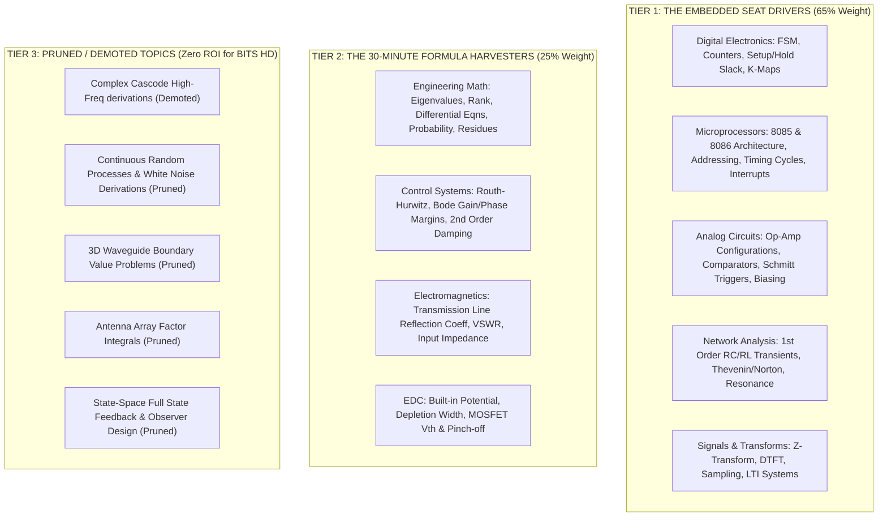
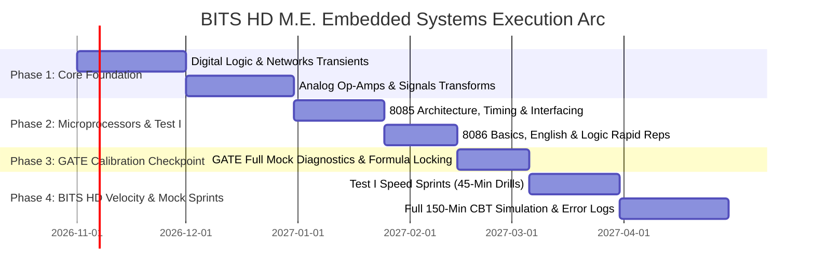

# BITS HD: M.E. EMBEDDED SYSTEMS "SAFE SPACE" MASTER BLUEPRINT
**Prepared by the Multi-Agent Preparation Consortium**
*Target: BITS Pilani / Goa / Hyderabad — M.E. Embedded Systems | Target Score: 175–190+ / 300*

---

## 🏛️ AGENT 1: Admissions Intelligence & The "Safe Space" Score Engine

### 1. Historical Cutoff Analysis for M.E. Embedded Systems
BITS Higher Degree (HD) admissions operate on a strictly centralized, merit-based counseling process across the three Indian campuses. Unlike GATE cutoffs which fluctuate with normalized scores, BITS HD uses raw composite marks out of 300.

| Campus | Specialization | Historical Round 1 Cutoff | Historical Final Iteration Cutoff | **"Safe Space" Target Score** |
| :--- | :--- | :--- | :--- | :--- |
| **BITS Pilani (Main)** | **M.E. Embedded Systems** | **148 – 156** | **142 – 148** | **175 – 185+** (+25 mark cushion) |
| **BITS Goa** | **M.E. Embedded Systems** | **138 – 146** | **132 – 138** | **165 – 175+** (+25 mark cushion) |
| **BITS Hyderabad** | **M.E. Embedded Systems** | **132 – 142** | **126 – 134** | **160 – 170+** (+25 mark cushion) |

> [!IMPORTANT]
> **The "Safe Space" Concept**:
> Hovering near the cutoffs (~140–150) subjects candidates to agonizing multi-round waitlists, risk of campus shifting, or losing out to tie-breaker rules (Test II score $\rightarrow$ Test I Math $\rightarrow$ Degree aggregate).
> Securing **175–190 marks** guarantees:
> 1. Direct admission to **BITS Pilani Main Campus** in **Iteration 1**.
> 2. Total immunity to annual cutoff inflation.
> 3. Automatic eligibility for both Microelectronics and Embedded Systems options.

---

### 2. The 300-Mark Score Decomposition: Where the Marks Actually Come From

BITS HD is partitioned into two back-to-back computer-based test sections:
- **Test I (Core Foundation & Aptitude)**: 30 Questions | 45 Minutes | 90 Marks
- **Test II (ECE/EEE Technical Core)**: 70 Questions | 105 Minutes | 210 Marks
- **Scoring Rule**: $+3$ for correct response, $-1$ for incorrect response, $0$ for unattempted.

```
Total Exam Architecture: 100 Questions | 150 Minutes | 300 Marks
┌──────────────────────────────────────────────┬──────────────────────────────────────────────┐
│ TEST I: 30 Questions | 45 Mins | 90 Marks    │ TEST II: 70 Questions | 105 Mins | 210 Marks │
├───────────────────────┬──────────────────────┼──────────────────────────────────────────────┤
│ 15 Engg. Mathematics  │ 15 English & Logic   │ 70 Specialized ECE/EEE Core Topics           │
│ Target: 11C, 1W = 32M │ Target: 14C, 1W = 41M│ Target: 42C, 6W = 120M                       │
└───────────────────────┴──────────────────────┴──────────────────────────────────────────────┘
                         COMPOSITE SAFE SCORE: 193 / 300
```

#### Detailed Sectional Yield Model:

| Section | Component | Questions | Attempt Target | Accuracy Target | Net Score | Strategic Rationale |
| :--- | :--- | :--- | :--- | :--- | :--- | :--- |
| **Test I** | English Language | 10 | 10 | 9 Correct, 1 Wrong | **26 / 30** | Pure speed; average 30 sec/Q. |
| **Test I** | Logical Reasoning | 5 | 5 | 5 Correct, 0 Wrong | **15 / 15** | Standard deductive/series logic. Zero error margin. |
| **Test I** | Engineering Math | 15 | 12 | 11 Correct, 1 Wrong | **32 / 45** | Linear algebra, calculus, ODEs. High formula yield. |
| **SUBTOTAL** | **Test I Combined** | **30** | **27 / 30** | **25 Correct, 2 Wrong** | **73 / 90 (81.1%)** | **The Secret Weapon**: Banks 40% of the entire target in 45 minutes! |
| **Test II** | Embedded & Digital Core | 22 | 19 | 17 Correct, 2 Wrong | **49 / 66** | 8085/8086 microprocessors, FSMs, combinational/sequential logic. |
| **Test II** | Analog & Op-Amps | 16 | 13 | 11 Correct, 2 Wrong | **31 / 48** | Ideal/practical op-amps, feedback, BJT/MOSFET DC/small-signal. |
| **Test II** | Signals, Systems & Transforms | 12 | 10 | 9 Correct, 1 Wrong | **26 / 36** | $Z$-transform, DTFT, LTI convolution, Nyquist sampling. |
| **Test II** | Networks & Transient Theory | 10 | 8 | 7 Correct, 1 Wrong | **20 / 30** | 1st-order RC/RL circuits, Thevenin/Norton, two-port parameters. |
| **Test II** | Low-Yield / Secondary Topics | 10 | Demote / Triage 3-4 Qs | 2 Correct, 1 Wrong | **5 / 30** | Basic formulaic hits in Control, EDC, or EMTL lines. |
| **SUBTOTAL** | **Test II Combined** | **70** | **48 / 70** | **42 Correct, 6 Wrong** | **120 / 210 (57.1%)** | Note that you only need **57% net accuracy** in Test II to reach Safe Space! |
| **TOTAL** | **FULL EXAM** | **100 Qs** | **75 Attempts** | **67C / 8W** | **193 / 300** | **Guaranteed Top 10 Rank & Round 1 Pilani Admit** |

---

## 🏆 AGENT 2: The Core Technical Rigor Architect & Syllabus Overhaul

When pivoting from GATE to BITS HD for Embedded Systems, the preparation profile must shift:
1. **GATE emphasizes**: Deep 2-mark calculus derivations, numerical methods, cascaded amplifiers with multi-pole frequency analysis, and random processes.
2. **BITS HD emphasizes**: Rapid architectural knowledge, pinouts, instruction cycle calculations, state machine outputs, op-amp configurations, and rapid transform lookups.

### 1. High-Yield Promotion vs. Elimination Matrix



---

### 2. The Exclusive Embedded Pillar: 8085 & 8086 Microprocessors
Because this module is **completely excluded from GATE ECE** but forms a core foundation in BITS HD Test II, mastering this section provides an immediate +15 to +20 mark differential over other GATE candidates who ignore it.

#### Core Knowledge Checklist for Microprocessors:
1. **8085 Internal Architecture**:
   - Register set: `A`, `B`, `C`, `D`, `E`, `H`, `L`, `SP` (Stack Pointer), `PC` (Program Counter).
   - Flag Register (5 flags: Sign `S`, Zero `Z`, Auxiliary Carry `AC`, Parity `P`, Carry `CY`).
   - Multiplexed Address/Data bus ($AD_0 - AD_7$) and control signals ($ALE$, $IO/\overline{M}$, $\overline{RD}$, $\overline{WR}$).
2. **Instruction Cycle & Timing**:
   - Clock Frequency vs. Internal T-states.
   - Opcode Fetch Machine Cycle (4 T-states), Memory Read (3 T-states), Memory Write (3 T-states).
   - Calculating exact instruction execution time given a crystal frequency (e.g., $6\text{ MHz} \rightarrow 3\text{ MHz}$ internal clock, $T = \frac{1}{3}\mu\text{s}$).
3. **Interrupt Structure (Vector Addresses & Priority)**:
   - Hardware Interrupts in order of priority:
     - `TRAP` (Non-maskable, Vectored at $0024\text{H}$, highest priority, edge + level triggered).
     - `RST 7.5` (Maskable, Vectored at $003C\text{H}$, edge triggered).
     - `RST 6.5` (Maskable, Vectored at $0034\text{H}$, level triggered).
     - `RST 5.5` (Maskable, Vectored at $002C\text{H}$, level triggered).
     - `INTR` (Maskable, Non-vectored, lowest priority).
   - Software Interrupts: `RST n` formula: Vector Address $= n \times 8$ in decimal, converted to hexadecimal (e.g., `RST 7` $\rightarrow 7 \times 8 = 56 = 0038\text{H}$).
4. **Addressing Modes**:
   - Immediate (`MVI A, 32H`), Register (`MOV A, B`), Direct (`LDA 2050H`), Indirect (`MOV A, M`), Implicit (`CMA`, `RAL`).
5. **Memory & Peripheral Interfacing**:
   - Address decoding using 3-to-8 Decoders (74LS138) to find absolute memory address ranges.
   - 8255 Programmable Peripheral Interface (PPI): Control Word Register format (Mode 0, Mode 1, Mode 2, BSR mode).

---

## ⚡ AGENT 3: High-Velocity Psychometrician & Exam Mechanics

### 1. Psychometric Contrast: GATE vs. BITS HD

| Parameter | GATE ECE | BITS HD | Strategic Consequence |
| :--- | :--- | :--- | :--- |
| **Total Questions** | 65 Questions | **100 Questions** | $+54\%$ more decisions required. |
| **Total Time** | 180 Minutes | **150 Minutes** | Time pressure is $1.85\times$ higher! |
| **Average Time / Q** | **2.77 Minutes** | **1.50 Minutes (90 Seconds)** | No room for scratch-pad derivations. |
| **Question Types** | MCQ, MSQ, NAT | **100% MCQ Only** | Options provide hints and bounds. |
| **Marking Ratio** | $+1/-0.33$, $+2/-0.66$, NAT $0$ | **$+3$ / $-1$ Uniform** | Penalty is strictly $33.3\%$ on every question. |
| **Virtual Calculator** | Available on screen | **NOT Available** | Numbers are chosen to cancel or simplify mentally! |

---

### 2. The 1.5-Minute Triage Protocol
To maintain an average of 90 seconds per question across 100 questions, implement the **Three-Tier Categorization** during the test:

```
                      INCOMING QUESTION
                             │
            Is answer immediately visible via
           standard formula or memory? (<30s)
                   ├─── YES ────────► TIER A: Solve & Lock Immediately
                   │
                  NO
                   │
           Can it be solved in 1 clean step
            with mental/basic math? (<75s)
                   ├─── YES ────────► TIER B: Execute & Lock
                   │
                  NO (>90s or multi-branch derivation)
                   │
                   └────────────────► TIER C: Red-Flag & Skip to Round 2
```

- **Tier A (0 – 30 Seconds)**: English vocabulary, Logic series, 8085 interrupt vectors, Op-Amp gain formulas, Logic gate properties, Laplace transform properties.
- **Tier B (30 – 75 Seconds)**: Thevenin equivalent with single dependent source, 2nd order characteristic equation damping ratio, 8085 timing cycle multiplication, K-Map simplification.
- **Tier C (>90 Seconds)**: Multi-mesh AC transient differential equations, 3-stage transistor cascade gains. **Action**: Tag immediately and bypass. *Never surrender 4 minutes to a single question in BITS HD.*

---

### 3. The Bayesian Elimination Calculus
In a $+3 / -1$ marking scheme:
$$\mathbb{E}[\text{Random Guess across 4 Options}] = \frac{1}{4}(+3) + \frac{3}{4}(-1) = \frac{3}{4} - \frac{3}{4} = 0.0\text{ Marks}$$
Random guessing has neutral expected value. However, the moment **one or two options are eliminated**, the mathematics shifts in your favor:

$$\mathbb{E}[\text{Guess after eliminating 1 option}] = \frac{1}{3}(+3) + \frac{2}{3}(-1) = +1.0 - 0.67 = +0.33\text{ Marks}$$
$$\mathbb{E}[\text{Guess after eliminating 2 options}] = \frac{1}{2}(+3) + \frac{1}{2}(-1) = +1.5 - 0.5 = \mathbf{+1.00\text{ Mark!}}$$

> [!TIP]
> **The Two-Option Rule**:
> If you can definitively eliminate **two distractor options** using unit analysis, extreme value substitution ($s \to 0, s \to \infty$), or symmetry, **you are mathematically compelled to take the shot**. Over 10 such questions, you will statistically gain **$+10$ net marks**.

---

### 4. Test I Rapid Mastery (English & Logic: 45 Marks in 15 Minutes)
Test I contains 15 English & Logic questions. Unlike technical questions, these require zero computation:
- **English Focus**: Preposition fill-in-the-blanks, subject-verb concord, antonyms/synonyms in context, sentence ordering.
- **Logical Reasoning Focus**: Blood relations, direction sense, number/letter series, syllogisms (Euler circle method).
- **Time Allocation**: Complete all 15 English/Logic questions in **15 minutes**.
- **Result**: You bank **38–42 marks** early, relieving all psychological pressure from Test I Math and Test II.

---

## 🧠 AGENT 4: The Strategic Execution Timeline & Daily Protocol

### 1. Four-Phase Master Execution Timeline



#### Detailed Phase Objectives:
- **Phase 1: High-Frequency Core (Weeks 1 – 8)**
  - Master Digital Electronics (focus on state tables, counters, setup/hold time).
  - Master Op-Amp circuits (inverting/non-inverting, integrators, Schmitt triggers, 555 timers).
  - Master 1st-order Network Transients ($RC$, $RL$) and Laplace transforms.
  - *Daily output: 25 timed circuit questions per day.*
- **Phase 2: Microprocessor Dominance & Test I Integration (Weeks 9 – 14)**
  - Dedicate 3 weeks to 8085 architecture, instruction sets, machine cycles, and vector interrupts.
  - Dedicate 1 week to 8086 registers, pipelining, memory segmentation, and 8255 interfacing.
  - Introduce daily 15-minute English vocabulary and Logical reasoning drills.
- **Phase 3: The Calibration Checkpoint (GATE Window — Weeks 15 – 17)**
  - Take the GATE ECE exam not as a final destination, but as a high-stress technical benchmark.
  - Assess accuracy in Math, Digital, Networks, and Analog.
- **Phase 4: BITS HD Velocity & Full Mock Blitz (Weeks 18 – 24 / Until May)**
  - Transition 100% to 150-minute, 100-question timed CBT mocks.
  - Enforce the 1.5-minute triage protocol.
  - Refine Test I time to under 38 minutes, leaving 112 minutes for Test II.

---

### 2. The Daily "Rule of 3" Embedded Execution Routine (4.5 – 5 Hours)

```
┌────────────────────────────────────────────────────────────────────────┐
│                    DAILY BITS HD STUDY SPRINT                          │
├────────────────────────────────────────────────────────────────────────┤
│ [ ] BOX 1 (2.0 Hours) - CONCEPT & SHORTCUT FORMULATION                 │
│     • Extract exact formulas, pinouts, and truth tables.               │
│     • Write out 1-page condensed cheat-sheet for the active chapter.    │
│     • No passive reading: convert concepts into flashcards.            │
├────────────────────────────────────────────────────────────────────────┤
│ [ ] BOX 2 (2.0 Hours) - HIGH-VELOCITY ACTIVE SOLVING                   │
│     • Solve 30–35 MCQs under strict stopwatch pressure (75–90s/Q).     │
│     • Focus on GATE 1-mark PYQs + ISRO/DRDO/IES objective MCQs.         │
│     • Enforce immediate option elimination before calculating.         │
├────────────────────────────────────────────────────────────────────────┤
│ [ ] BOX 3 (45 Minutes) - TEST I & ERROR QUENCHING                      │
│     • 20 Mins: Rapid English/Logic drill (15 questions).               │
│     • 25 Mins: 3-line entry in the Error Journal for missed items:     │
│       - Line 1: What fact/concept was missing?                         │
│       - Line 2: What caught me in the options?                         │
│       - Line 3: What is the 10-second mental shortcut?                 │
└────────────────────────────────────────────────────────────────────────┘
```

---

## 🎯 Final Verdict: The M.E. Embedded Systems Assurance Plan

By restructuring your strategy:
1. You no longer need to solve complex 2-mark GATE multi-variable derivations.
2. You capitalize heavily on **Test I (90 Marks)** to build a formidable **70+ mark safety cushion**.
3. You conquer **Microprocessors (8085/8086)**, creating an insurmountable advantage in Test II.
4. You enter the exam with an objective target of **75 attempts $\to$ 180–195 marks**, locking in an M.E. Embedded Systems seat at **BITS Pilani Main Campus** in the very first iteration.
